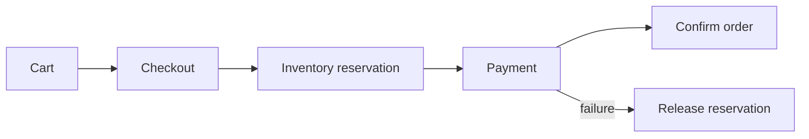

# Omnichannel Commerce

Spring Boot modular-monolith starter for catalog, cart, inventory reservation, checkout orchestration, payments, and JWT security.

## Run locally (no Docker)

`./mvnw spring-boot:run` starts the default H2-backed `dev` profile at `http://localhost:8080`. Swagger is at `/swagger-ui/index.html`; the H2 console is `/h2-console` (JDBC URL: `jdbc:h2:mem:commerce`).

Seeded passwords are all `password`: `admin@example.com`, `staff@example.com`, and `customer@example.com`.

## Run with Docker

Run `./mvnw package -DskipTests`, then `docker compose up --build`. This selects the PostgreSQL `prod` profile.

## Core flow

Login using `POST /api/auth/login`, create a cart, add items, and send `POST /api/checkout` with an `Authorization: Bearer …` token and a unique `Idempotency-Key`. Inventory is locked and reserved before payment, then committed only after a captured payment.

